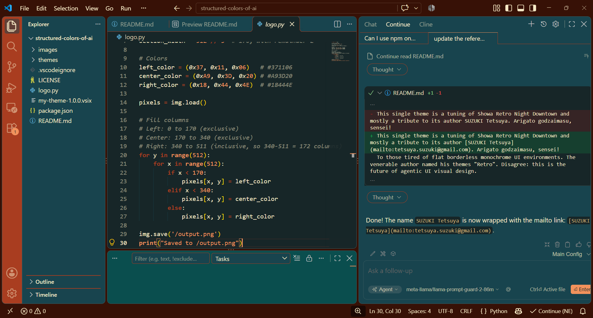

# Structured Colors of AI

Searched in vain for the themes where functionally distinct areas would be meaningfully colored. The best (and unique) match is the grandiose [Showa Retro Themes](https://marketplace.visualstudio.com/items?itemName=szktty0508.showa-retro-themes).

This single theme is a tuning of Showa Retro Night Downtown and mostly a tribute to its author [SUZUKI Tetsuya](mailto:tetsuya.suzuki@gmail.com). Arigato godzaimasu, sensei!

To those tired of flat borderless monochrome UI environments. The venerable author named his themes "Retro". Disagree: this is the future of agentic UI visual design.

## What I've tuned

I highly appreciate the overall idea and exquisite selection of colors by master Suzuki, but my personal taste slightly differs. I've tried to modify as little as possible:
 - Global base color #A93D20 is replaced with the almost the same hue, but much darker #371106
 - Activity panel is now the former base #A93D20
 - Panel background is #0A4E4E slightly lighter than #18444E

 ## Historic and cultural background

 Flat monolithic and monotone borderless design is not a result of competing trends. It is a deliberate decision: such design should support the programmers' flow, focus and concentration, making them more productive. Productive when typing the code in the editor.

 Leaving aside the effectiveness of this noble intent, by the end of 2026 there could be some faint doubts about whether the concentrated typing is still the coding mainstream. (Hint: in the age of AI assistants and agents it isn't.)

 So why stick to the outdated visual layout when its raison d'etre disappears? Slowly and irreversibly.  Agentic workflow is quite different; it requires no less mental efforts, but of a very different kind. Adding the mental load of distinguishing agentic, editor, navigation and terminal windows instead of instant subconscious color classification is not a good idea any more.  

 Hopefully, in a couple of years UI designers will announce a new, revolutionary structured look and sell it to customers for extra price. Good luck, guys! :))

## Installation

1. Open VS Code
2. Click on the Extensions icon in the sidebar (or press `Ctrl+Shift+X` / `Cmd+Shift+X`)
3. Search for "Structured Colors of AI"
4. Click "Install"

Alternatively, you can install it directly from the [VS Code Marketplace](https://marketplace.visualstudio.com/items?itemName=alexis-pokrovski.structured-colors-of-ai).

## Applying Themes

1. Press `Ctrl+K Ctrl+T` (Windows/Linux) or `Cmd+K Cmd+T` (macOS) in VS Code
2. Select a theme that begins with "Structured Colors" from the theme list

Or:

1. Select `File > Preferences > Color Theme`
2. Choose a theme that begins with "Structured Colors"

## Feedback & Contributions

Please report bugs or feature requests on [GitHub Issues](https://github.com/Quantification/structured-colors-of-ai/issues).

If you enjoy these themes, please consider rating and reviewing them on the [VS Code Marketplace](https://marketplace.visualstudio.com/items?itemName=alexis-pokrovski.structured-colors-of-ai).

## License

[MIT License](LICENSE)

## Developer

Alexis Pokrovski <alexis.pokrovski@mail.ru>